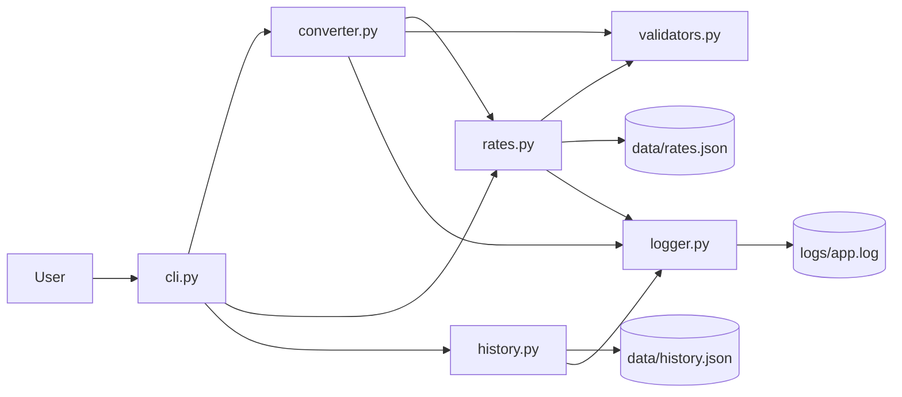
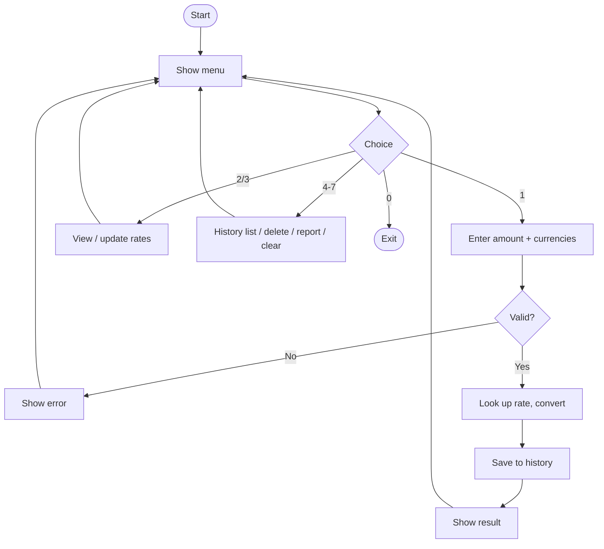
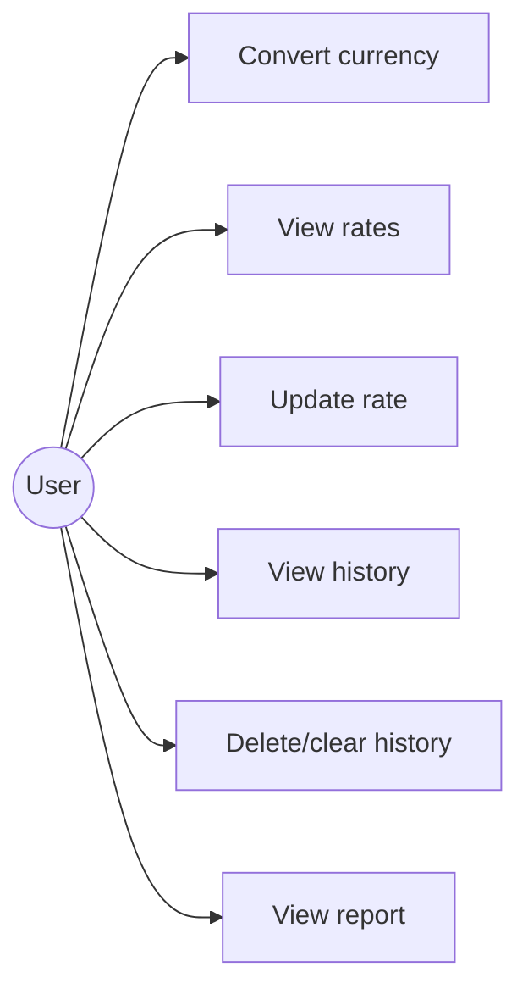
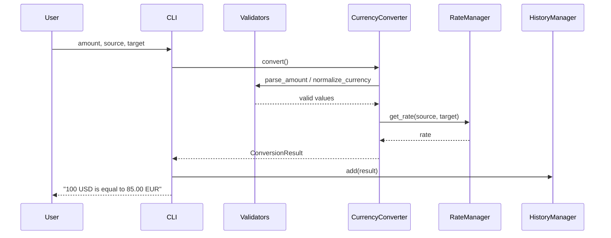
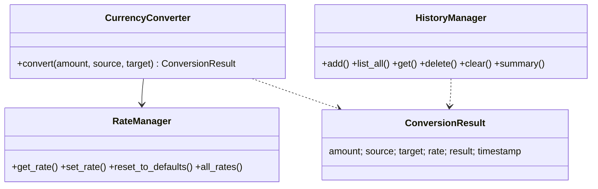

# Design Documentation

## Objectives
- Convert currencies accurately with validated input
- Keep exchange rates maintainable without editing code
- Record and analyse conversion history
- Be modular, tested and fault tolerant

## Functional Requirements
| ID | Requirement |
|----|-------------|
| FR1 | Convert an amount between supported currencies (Module 1) |
| FR2 | View, update and reset exchange rates (Module 2) |
| FR3 | Store, list, delete and clear conversion history (Module 3) |
| FR4 | Show history report (count, most-used pair, totals) |
| FR5 | Menu-driven workflow with clear input/output |

## Non-Functional Requirements
| Type | Requirement |
|------|-------------|
| Usability | Menu-driven CLI; clear, human-readable error messages |
| Reliability | Corrupt/missing data files fall back to defaults; app never crashes on bad input |
| Maintainability | Separate modules with single responsibilities; rates in JSON not code |
| Error handling | Custom exception hierarchy caught centrally in the CLI |
| Logging | Rotating log file records conversions, updates and errors |
| Resource efficiency | History capped at 500 entries; standard library only |
| Security | Strict validation rejects NaN, infinity, negative and non-numeric input |

## System Architecture

## Workflow Diagram

## Use Case Diagram

## Sequence Diagram (Convert)

## Class Diagram

## Storage Design
- `data/rates.json`: `{ "USD": {"EUR": 0.85, "CAD": 1.25}, ... }`
- `data/history.json`: list of `{amount, source, target, rate, result, timestamp}`

## Design Decisions
- **Layered modules** - CLI knows nothing about maths; core classes know nothing about `input()`, so they are testable.
- **Dependency injection** - managers accept file paths, letting tests use temp files.
- **JSON storage** - simple, human-editable, no database needed at this scale.
- **Custom exceptions** - the CLI catches one base class and shows friendly messages.
